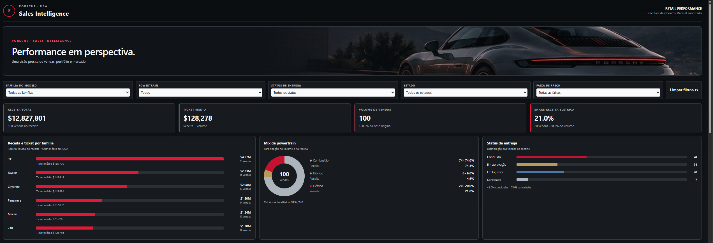

# dashboard_porshe_dio

Porsche Sales Intelligence 🏎️
Dashboard interativo de Business Intelligence para explorar vendas de veículos Porsche nos Estados Unidos. O projeto transforma uma base tabular de vendas em indicadores e visualizações que ajudam a entender receita, ticket médio, mix de motorização, concentração geográfica e perfil de compra.

A interface utiliza o conceito visual Porsche Graphite: fundo grafite, cartões escuros, destaques em vermelho, tipografia discreta e uma imagem automotiva no cabeçalho.
Aviso: projeto independente, desenvolvido para fins de portfólio e análise de dados. Não é um produto oficial nem possui vínculo com a Porsche. Os resultados apresentados refletem exclusivamente a base de dados incluída no projeto, não as vendas oficiais da marca.

Funcionalidades
- Indicadores principais: receita total, ticket médio, volume de vendas e participação dos elétricos em receita e quantidade.
- Receita por família de modelo: comparação entre faturamento e ticket médio das famílias 911, 718, Cayenne, Macan, Panamera e Taycan.
- Mix de powertrain: distribuição de combustão, híbridos e elétricos.
- Status de entrega: visão consolidada dos pedidos concluídos, em aprovação, em logística e cancelados.
- Distribuição por estado: ranking dos cinco estados de maior receita, com os demais agrupados em Outros para facilitar a leitura.
- Perfil regional de compra: resumo por região dos EUA, incluindo família mais vendida, faixa de preço predominante e forma de pagamento mais comum.
- Filtros combináveis: família do modelo, tipo de motorização, status de entrega, estado e faixa de preço, além da opção Limpar filtros.
Todos os indicadores e gráficos são recalculados conforme os filtros aplicados.
Prévia
Abra o arquivo site-preview.html no navegador para visualizar e interagir com o dashboard.

Para incluir uma captura de tela no repositório, salve uma imagem em assets/dashboard-preview.png e adicione ao README:

Tecnologias
Tecnologia	Utilização
HTML5	Estrutura do dashboard
CSS3	Layout responsivo e identidade visual Porsche Graphite
JavaScript (Vanilla JS)	Filtros, agregações, KPIs e renderização das visualizações
Excel (.xlsx)	Origem dos dados utilizados na preparação da dashboard

A página é estática e autocontida: não requer framework, servidor de aplicação ou instalação de dependências. A imagem do cabeçalho e os registros utilizados pelo painel estão incorporados ao HTML.
Como executar
1. Clone o repositório ou baixe seus arquivos.
2. Abra site-preview.html em um navegador moderno.
3. Utilize os filtros no topo da página para explorar diferentes recortes dos dados.
4. Clique em Limpar filtros para voltar à visão geral.
Também é possível publicar a página em um serviço de hospedagem estática, como o GitHub Pages. Para usá-la como página inicial do site, renomeie ou copie site-preview.html para index.html.
Base de dados
O painel foi atualizado a partir do arquivo porche_database_sanitized_v2.xlsx, que contém os campos necessários para as segmentações, inclusive as classificações de faixa de preço e status agrupado de entrega.

O conjunto de dados incorporado à versão atual do dashboard contém 100 registros. Entre os atributos utilizados estão:
- Modelo e família do veículo;
- Tipo de motorização (powertrain);
- Preço da venda e faixa de preço;
- Cidade e estado;
- Forma de pagamento;
- Status de entrega agrupado.
Importante: o HTML contém uma cópia dos registros preparada para a visualização. Alterar a planilha .xlsx isoladamente não atualiza o painel; é necessário atualizar também o conjunto de dados incorporado ao JavaScript.
Perguntas de negócio
1. Quais famílias de modelos geram mais receita e qual é o ticket médio de cada uma?
2. Qual é a participação dos veículos elétricos na receita e no volume de vendas?
3. Em quais estados a receita está mais concentrada?
4. Como o perfil de compra varia entre as regiões dos Estados Unidos?
5. Como os resultados mudam ao combinar filtros de modelo, motorização, status e preço?
Evolução do projeto
O desenvolvimento passou por quatro etapas principais:
1. Construção do painel: definição dos indicadores e visualizações com base nas perguntas de negócio.
2. Ajuste das segmentações: simplificação das famílias de modelos, dos status de entrega e das faixas de preço para tornar a análise mais intuitiva.
3. Atualização da base: adoção de porche_database_sanitized_v2.xlsx, com as classificações necessárias já disponíveis nos dados, e revisão do funcionamento dos filtros combinados.
4. Refinamento visual: criação do tema Porsche Graphite, melhoria de contraste dos controles e inclusão de imagem automotiva no cabeçalho.

